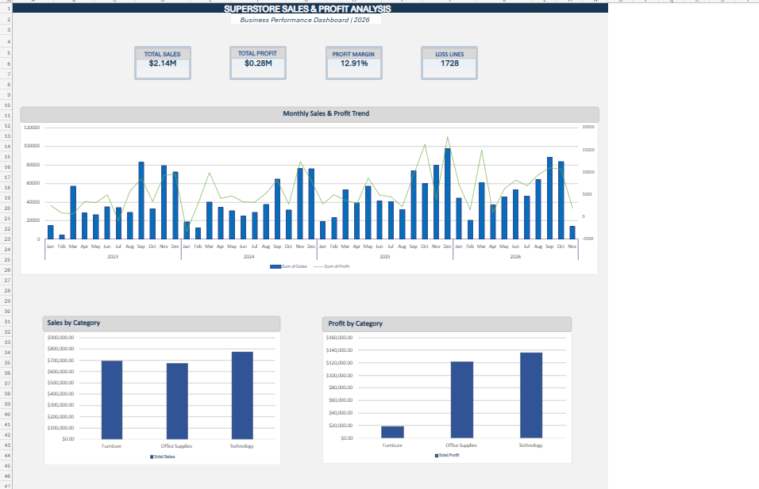
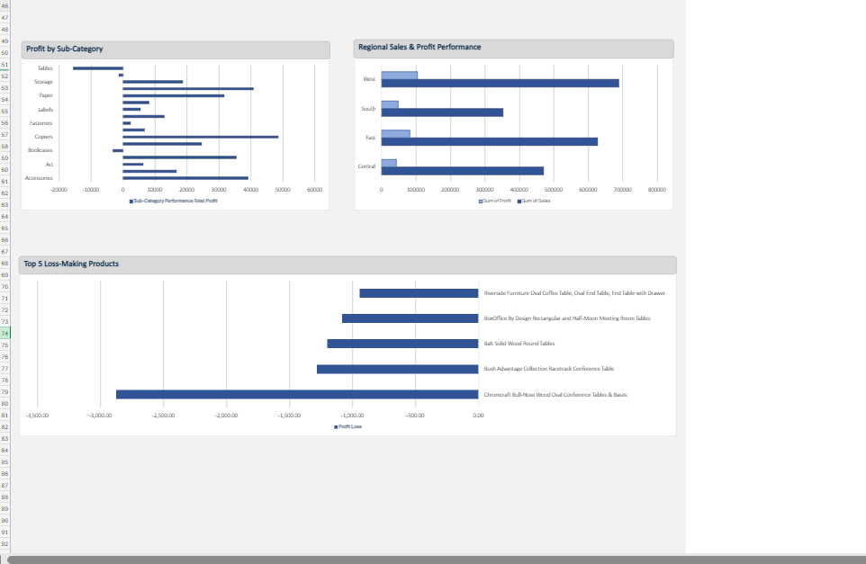

# Superstore Sales & Profitability Analysis

**Business performance analysis using Microsoft Excel**

📄 [Read the full project report (PDF)](report/Superstore_Sales_Profitability_Project_Documentation.pdf)

[Project overview](#project-overview) · [Objectives](#objectives) · [Dataset and scope](#dataset-and-scope) · [Dashboard KPIs](#dashboard-kpis-selected-date-range) · [Insights](#top-five-business-insights) · [Additional findings](#additional-findings) · [Recommendations](#recommendations) · [Repository structure](#repository-structure) · [Limitations](#limitations) · [Conclusion](#conclusion) · [Author](#author)

---

## Project overview

This project analyses Superstore sales and profitability using **Microsoft Excel**. It compares performance across categories, sub-categories, regions, customer segments and shipping modes, and investigates customer performance, returns, discount patterns and loss-making products. PivotTables, filters, calculations and charts support the analysis and dashboard.

> This project was completed in Microsoft Excel. SQL, Python and Power BI were not used.

## Objectives

- Track sales, profit, profit margin and loss-making order lines.
- Compare product, regional, segment and shipping performance.
- Review customer performance and return-associated order lines.
- Investigate loss-making products and discount patterns.
- Present findings in a business performance dashboard.

## Dataset and scope

- **Orders worksheet:** 10,195 data records.
- **Returns worksheet:** 296 records.
- **People worksheet:** regional manager information.
- Dashboard and supporting PivotTables use a selected date range. The return analysis includes 9,304 order lines.
- 2026 figures run through November 3, 2026 and are incomplete.
- The original dataset source was not verified in the supplied project material.

## Dashboard KPIs (selected date range)

| Metric | Result |
|---|---:|
| Total Sales | $2,136,657.57 |
| Total Profit | $275,912.14 |
| Profit Margin | 12.91% |
| Loss-making order lines | 1,728 |





## Top five business insights

1. Tables recorded the highest sub-category loss of **$15,523.10**.
2. A 70% discount on a Machines transaction for Cindy Stewart was associated with a **$6,599.98 loss**.
3. West had the highest regional profit margin (**15.12%**), while Central had the lowest (**9.09%**).
4. Office Supplies had the highest category margin (**18.03%**), compared with Furniture at **2.70%**.
5. The five largest loss-making products had combined losses of **$7,384.11**.

## Additional findings

- Technology generated the highest category sales ($772,686.81) and profit ($136,067.73).
- Consumer generated the highest segment sales and profit; Corporate had the highest segment margin (14.48%).
- Standard Class generated the highest shipping-mode sales and profit; Same Day had the highest margin (17.42%).
- 2025 was the strongest full year in the supplied analysis for sales and profit. 2026 is incomplete through November 3.
- Cindy Stewart recorded a selected-period net loss of $6,626.39; Machines accounted for approximately 96.7% of that loss.
- 722 of 9,304 analysed order lines were associated with returned orders (7.76%). This is an order-line count, not a distinct returned-order count.
- Tables discount groups shown had negative average profit at discount levels of 20%–50%, while the no-discount group had positive average profit. This is an association, not proof of causation.

## Recommendations

- Review pricing, costs and discount rules for loss-making sub-categories.
- Investigate high-discount Machines transactions.
- Review the drivers behind Central region’s lower margin.
- Investigate Furniture’s low category margin.
- Prioritise the five identified loss-making products for further review.
- Monitor returns using clearly defined order-line and distinct-order measures.

## Repository structure

```text
superstore-sales-profitability-analysis/
├── README.md
├── .gitignore
├── report/
│   └── Superstore_Sales_Profitability_Project_Documentation.pdf
├── source-export/
│   └── source_analysis_export.pdf
└── images/
    ├── dashboard_top.png
    ├── dashboard_bottom.png
    └── supporting-analysis/
        ├── evidence_1_1.png
        ├── evidence_1_2.png
        ├── evidence_1_3.png
        ├── evidence_2_1.png
        ├── evidence_2_2.png
        └── evidence_2_3.png
```

The report PDF is a documentation deliverable, not an editable workbook.

## Limitations

- The reported KPIs and many PivotTables use a selected date range, not all source rows.
- The 2026 period is incomplete.
- Return-associated counts refer to order lines, not distinct returned orders.
- Discount and loss patterns show association, not causation.
- The original dataset source was not verified.
- The documentation is based on visible results in the supplied PDF export; formulas, PivotTable refresh behaviour and interactive filters were not independently tested.

## Conclusion

The project demonstrates practical Excel-based analysis and dashboard reporting. It identifies performance differences, investigates profitability issues and presents findings that can guide further business review.

---

## Author

**S L Vandana**

[LinkedIn](https://www.linkedin.com/in/slvandana)
